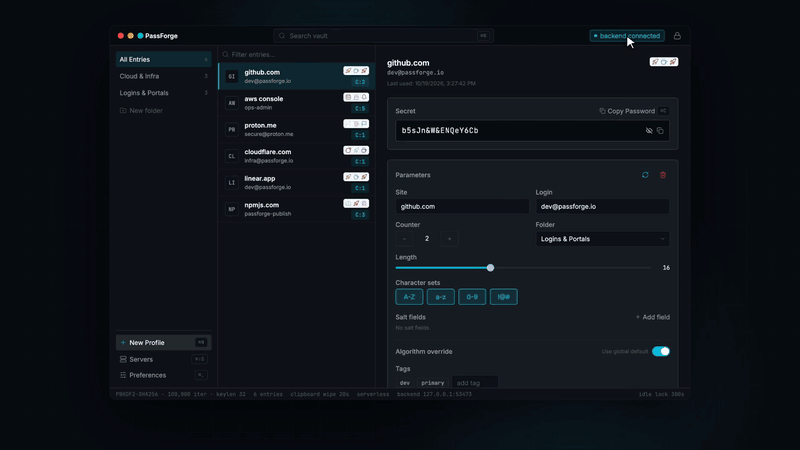

<p align="center"></p>

# PassForge

**A stateless password manager where the frontends can't generate a single password on their own.**

<p align="center">
  <a href="https://github.com/benforcapita/PassForge/releases/download/demo-video/passforge-demo.mp4">
    
  </a>
  <br />
  <sub>▶ <a href="https://github.com/benforcapita/PassForge/releases/download/demo-video/passforge-demo.mp4"><b>Watch the full 2-minute demo</b></a> (MP4, 1080p, with sound) · <a href="https://github.com/benforcapita/PassForge/releases/tag/demo-video">release page</a></sub>
</p>

PassForge regenerates every password deterministically from a *site*, a *login* and your *master password* — nothing is stored, nothing is synced, there are no accounts. It is a fork of [LessPass](https://github.com/lesspass/lesspass) that keeps the algorithm and drops the cloud.

What makes PassForge different is an architecture rule that this repository enforces end to end:

> **Frontends are severed from the algorithm.** The desktop window and the browser extension contain no password-derivation code. They are clients of a **local backend** (a loopback HTTP API embedded in the desktop app). No backend connection → no password. The backend, in turn, can derive on its own (*serverless*) or through an optional, interchangeable, zero-knowledge **algorithm server** that you host yourself.

Both frontends ship with a **Servers** panel that lets you see, connect to and disconnect from each of those two layers — and watch generation stop working the moment the backend is gone.

---

## Download

**[⬇ Latest release](https://github.com/benforcapita/PassForge/releases/latest)** — macOS 13+ (Apple Silicon and Intel).

| File | What it is |
|---|---|
| `PassForge-<version>.pkg` | **Recommended.** Installer package — drops the app in `/Applications` and registers the browser companion for you |
| `PassForge_<version>_universal.dmg` | The desktop app with its embedded backend (drag-to-install) |
| `passforge-extension-<version>.zip` | The Chrome extension (also works in Brave, Edge, Arc, Chromium) |
| `install-server.sh` | One-line installer for the algorithm server (systemd / launchd) |
| `passforge-server-<version>-<os>-<arch>.tar.gz` | Optional self-hosted algorithm server (macOS universal, Linux x86_64 / aarch64) |
| `SHA256SUMS` | Checksums: `shasum -a 256 -c SHA256SUMS` |

**Install the app**

- **pkg (recommended):** open `PassForge-<version>.pkg` and follow the installer. It puts
  `PassForge.app` in `/Applications` and registers the native-messaging helper with your browsers automatically.
- **dmg:** open `PassForge_<version>_universal.dmg` and drag **PassForge** into **Applications**.
- **Homebrew:** `brew install --cask benforcapita/passforge/passforge`
  (requires the `benforcapita/homebrew-passforge` tap — populated from `packaging/homebrew/`).
- Launch it. Unsigned (not yet notarized) builds are blocked once by macOS:
  open **System Settings → Privacy & Security**, scroll to *"PassForge" was blocked…* and click **Open Anyway**.
  Terminal alternative: `xattr -dr com.apple.quarantine /Applications/PassForge.app`.
- Click **Always Allow** on the Keychain prompt (the vault key lives in your Keychain), then pick your master password.

On every launch the app registers its native-messaging helper with each installed Chromium-family browser, so there is no script to run.

**Install the extension**

1. Unzip `passforge-extension-<version>.zip`.
2. `chrome://extensions` → enable **Developer mode** → **Load unpacked** → choose the unzipped folder.
3. The ID is always **`ihgkdijknaongdcmebhaaiagcafmnaic`** (pinned by the manifest's public key), which is what the app registers.
4. Open the popup (⌘⇧L) → **Servers** → **Connect**. The first connection triggers one more Keychain prompt for the helper — **Always Allow**.

**Updating:** replace the app in Applications and reload the extension. Because builds are ad-hoc signed, macOS treats each version as a new app: expect the *Open Anyway* step and the Keychain prompts once per update. Your vault is untouched.

To build from source instead, see [Quick start](#3-quick-start-macos).

---

## Table of contents

1. [How it works](#1-how-it-works)
2. [Repository layout](#2-repository-layout)
3. [Quick start (macOS)](#3-quick-start-macos)
4. [The desktop app and its embedded backend](#4-the-desktop-app-and-its-embedded-backend)
5. [The Chrome extension](#5-the-chrome-extension)
6. [The Servers panel — demonstrating the severance](#6-the-servers-panel--demonstrating-the-severance)
7. [Deploying your own algorithm server](#7-deploying-your-own-algorithm-server)
8. [The CLI](#8-the-cli)
9. [Local backend API reference](#9-local-backend-api-reference)
10. [Security model](#10-security-model)
11. [Development](#11-development)
12. [Troubleshooting](#12-troubleshooting)
13. [License and credit](#13-license-and-credit)

---

## 1. How it works

### The algorithm (unchanged from LessPass)

```
entropy  = PBKDF2-HMAC-SHA256( master_password, site ‖ login ‖ counter, 100 000 iterations )
password = render( entropy, { lowercase, uppercase, digits, symbols, length } )
```

Same inputs, same password — forever, on any device. Change the counter to rotate a password. The master password is never stored anywhere; a visual **fingerprint** (three coloured glyphs) tells you that you typed it correctly.

### Three layers

```
┌──────────────────────────┐     ┌──────────────────────────┐
│  Desktop window (React)  │     │  Chrome extension (MV3)  │      FRONTENDS
│  no algorithm inside     │     │  no algorithm inside     │      (thin clients)
└────────────┬─────────────┘     └────────────┬─────────────┘
             │ http://127.0.0.1:<port>        │ pairs via native host,
             │ Bearer <api-token>             │ then same HTTP API
             ▼                                ▼
┌──────────────────────────────────────────────────────────────┐
│  LOCAL BACKEND  — embedded in PassForge.app's process        │
│  axum on loopback · bearer token · unlock-gated vault routes │  BACKEND
│  lesspass-core (Rust) · SQLCipher vault · macOS Keychain     │
└───────────────────────────┬──────────────────────────────────┘
                            │ optional: one blinded 32-byte hash per password
                            ▼
┌──────────────────────────────────────────────────────────────┐
│  ALGORITHM SERVER  — passforge-server (self-hosted, optional)│  ALGORITHM SERVER
│  stateless · zero-knowledge · Argon2id / PBKDF2 / pepper     │  (interchangeable)
└──────────────────────────────────────────────────────────────┘
```

| Layer | What it knows | What it can do alone |
|---|---|---|
| **Frontend** | site, login, master password (typed), UI state | Nothing. Reveal/Copy/Generate are HTTP calls. |
| **Local backend** | everything above + the vault (entry parameters) + settings | Derive passwords (serverless) or delegate to an algorithm server. |
| **Algorithm server** | one blinded hash per request — never site, login, master password, settings or the resulting password | Return bytes the backend mixes with a key that never leaves your machine. |

### Two kinds of "server"

People reasonably ask "which server?" — there are two, and the Servers panel has one section for each:

1. **Backend** (section 1) — the local API inside `PassForge.app`. **Required.** This is what makes the frontends thin.
2. **Algorithm server** (section 2) — `passforge-server`, or any implementation of [`passforge-remote-v1`](docs/remote-protocol.md). **Optional.** With none selected the backend uses the built-in LessPass algorithm ("serverless").

---

## 2. Repository layout

```
desktop/                     Tauri v2 + React 19 desktop app
  src/                       UI (Workbench, Servers panel, Preferences, lock screen)
  src/backend.ts             the UI's connection to the local backend (HTTP)
  src-tauri/                 Rust crate `passforge-desktop`
    src/api.rs               the local backend: axum router, token, CORS
    src/commands.rs          IPC commands + shared derivation helpers
    src/bin/passforge-host.rs  Chrome native-messaging host (sidecar)
    src/native_messaging.rs  host wire protocol (ping / search / get_entry / api_info)
    src/remote.rs            client for algorithm servers (ureq)
    src/keychain.rs          vault key in macOS Keychain
    native-messaging/        host manifest template + install script
crates/lesspass-core/        the password algorithm (the only place it exists)
crates/passforge-protocol/   client primitives for passforge-remote-v1 (blind / finish)
crates/passforge-server/     reference algorithm server (axum)
packages/passforge-extension/  Chromium MV3 extension (React) — no algorithm code
cli/                         Python CLI (`pip install lesspass`), optional --server
docs/
  remote-protocol.md         the algorithm-server protocol, byte for byte
  security-checklist.md      what is and isn't covered
  macos-verification.md      things to verify on real hardware
  design-system/             "Obsidian Precision" UI tokens
scripts/build-mac.sh         one-shot: build .app + sidecar, install host manifest
```

---

## 3. Quick start (macOS)

### Prerequisites

| Tool | Why | Install |
|---|---|---|
| Rust (stable) + Cargo | backend, server, host | `brew install rustup && rustup-init` or <https://rustup.rs> |
| `cargo-tauri` 2.x | builds the `.app` | `cargo install tauri-cli --version '^2'` |
| Node 22 + Yarn 4 | React frontends | `brew install node@22 && corepack enable` (Node ≥ 25 dropped corepack: `npm i -g corepack`) |
| Xcode command line tools | linking, bundling | `xcode-select --install` |
| Python 3.8+ (optional) | CLI | preinstalled / `brew install python` |

### Build everything and launch

```bash
git clone git@github.com:benforcapita/PassForge.git
cd PassForge
yarn install
./scripts/build-mac.sh           # builds PassForge.app with the native host bundled, then opens it
```

Or step by step:

```bash
yarn build                                   # desktop + extension bundles
cd desktop && cargo tauri build && cd ..     # → target/release/bundle/macos/PassForge.app
open target/release/bundle/macos/PassForge.app
```

On first launch the app:

1. creates a SQLCipher vault at `~/Library/Application Support/PassForge/passforge.db`, with a random 32-byte key stored in the **macOS Keychain** (`com.passforge.desktop` / `database-key`);
2. starts the **local backend** on `127.0.0.1:<ephemeral port>` and writes `api-info.json` (port) and `api-token` (0600) next to the vault;
3. shows the lock screen — enter any master password you choose. There is no "sign-up": the master password is an *input to the algorithm*, not a credential that is checked against anything.

> **Keychain prompts.** The first time a given binary opens the vault, macOS asks whether it may read `database-key`. Click **Always Allow**. Every rebuilt binary is a new identity to Keychain, so you'll see the prompt again after each `cargo tauri build`. Denying the prompt is safe: since commit `b5248924` a denied read is a hard error, never a silent key rewrite.

### Verify the backend is alive

```bash
DIR="$HOME/Library/Application Support/PassForge"
PORT=$(python3 -c "import json;print(json.load(open('$DIR/api-info.json'))['port'])")
TOKEN=$(cat "$DIR/api-token")
curl -H "Authorization: Bearer $TOKEN" http://127.0.0.1:$PORT/api/health
# {"locked":false,"version":"12.0.0"}
```

---

## 4. The desktop app and its embedded backend

### The window

- **Sidebar** — folders, *New Profile* (⌘N), **Servers** (⌘⇧S), *Preferences* (⌘,).
- **Entry list** — site / login / counter / fingerprint; ⌘K to filter.
- **Detail pane** — the **Secret** well (Reveal, Copy ⌘C with timed clipboard wipe), **Parameters** (counter, length, character sets, salt fields, per-entry crypto override), folders and tags.
- **Header chip** — `● backend connected` / `○ backend disconnected`. Click it to open Servers.
- **Status bar** — crypto config, entry count, clipboard wipe, generation mode (`serverless` or `server · host · algorithm`), backend address, idle-lock countdown.

### What's actually happening when you click Reveal

```
Workbench ──backend.generate(entryId)──▶ POST http://127.0.0.1:<port>/api/entries/{id}/generate
                                          Authorization: Bearer <token>
                                          (backend: require unlocked session,
                                           load entry + settings,
                                           derive with session master password,
                                           mark entry used)
          ◀────────── { "password": "…" } ────────────
```

The React code never sees the algorithm. `desktop/src/backend.ts` obtains the port and token through one IPC call (`backend_info`) and from then on speaks plain HTTP, exactly like the extension. If you **Disconnect** in the Servers panel, `backend.ts` drops the credentials and `generate()` throws *"Not connected to the PassForge backend"* — there is no fallback.

### The vault

The vault stores **parameters, never passwords**: site, login, counter, character-set options, length, salt fields, optional per-entry crypto override, folder, tags, timestamps. Losing the vault file loses nothing you can't retype; losing your master password loses everything. Export/Import (Preferences → Vault data) produce plain JSON of those parameters.

### Locking

The master password lives only in RAM inside the backend's `SessionState` and is zeroized on **Lock** (⌘L), on the configurable **idle timeout**, and on quit. While locked, the backend serves no vault data (`403` on vault routes) and the frontends show the lock screen. Optional **Touch ID** can feed a Keychain-remembered master password to `unlock` — a convenience gate, not a security boundary.

---

## 5. The Chrome extension

`packages/passforge-extension` is a Manifest V3 popup. It contains **no derivation code**: generation and the key fingerprint are `fetch` calls to the local backend. If the backend isn't connected, **Generate** and **Copy** are disabled and the popup says so.

### How the extension finds the backend

The backend's port is ephemeral and its token is a secret file, so the extension doesn't ask you to type anything. It talks to the **native-messaging host** `passforge-host` (bundled inside `PassForge.app`), which reads `api-info.json` and `api-token` from the vault directory and hands back `{ port, token }`. Pairing is therefore based on OS file permissions: whoever can run the host as your user can pair.

```
popup ──chrome.runtime.sendNativeMessage("com.passforge.desktop", {op:"api_info"})──▶ passforge-host
      ◀──────────────────────── { port, token } ──────────────────────────────────────
popup ──GET http://127.0.0.1:<port>/api/health  (Bearer token)──▶ backend   → "backend connected"
```

The host also answers `ping`, `search` and `get_entry`, which is how the popup prefills login / counter / options for the site in the active tab.

### Install (sideload) — step by step

**1. Build the extension**

```bash
yarn workspace passforge-extension build      # → packages/passforge-extension/dist
```

**2. Load it in Chrome**

1. Open `chrome://extensions`.
2. Enable **Developer mode** (top right).
3. **Load unpacked** → choose `packages/passforge-extension/dist` (absolute path; in the file dialog press ⌘⇧G and paste it).
4. The card shows the ID **`ihgkdijknaongdcmebhaaiagcafmnaic`**. It is pinned by the public `key` in `public/manifest.json`, so it is the same on every machine and every path (a test in `browser_hosts_tests.rs` keeps the key and the app's constant in sync). The matching private key is not in the repo; it's only needed for a future Chrome Web Store / CRX upload.

**3. The native-messaging host is registered by the app**

On every launch, `PassForge.app` writes `com.passforge.desktop.json` into the `NativeMessagingHosts` directory of each installed Chromium-family browser (Chrome, Chrome Beta, Chromium, Brave, Edge, Arc), pointing at its own bundled helper:

```json
{
  "name": "com.passforge.desktop",
  "path": "/Applications/PassForge.app/Contents/MacOS/passforge-host",
  "type": "stdio",
  "allowed_origins": ["chrome-extension://ihgkdijknaongdcmebhaaiagcafmnaic/"]
}
```

It only rewrites the file when it changed, so moving the app just works after one relaunch. To register manually (e.g. a dev build that isn't running), `./desktop/src-tauri/native-messaging/install-host.sh <path-to-passforge-host> [extension-id] [chrome|chromium|edge|brave]` still works; the extension ID defaults to the pinned one.

**4. Allow the host to read the vault key**

The first time Chrome launches `passforge-host`, macOS shows a Keychain prompt for `database-key`. Click **Always Allow**. (You can trigger it outside Chrome to get it over with — see [Troubleshooting](#12-troubleshooting).)

**5. Use it**

Click the toolbar icon (pin it via the puzzle-piece menu) or press **⌘⇧L**.

- First run: badge **`backend disconnected`**, a warning strip, Generate/Copy greyed out. *This is intentional*: the dependency is visible.
- **Servers** tab → **Connect**. The badge turns **`backend connected`** and the backend row shows `http://127.0.0.1:<port> · v12.0.0`.
- **Generate** tab: type the master password → fingerprint glyphs appear (computed by the backend) → **Generate** / **Copy**.
- Your Connect/Disconnect choice is remembered (`chrome.storage.local`) across popup opens.

### Autofill

Login and signup forms get a small PassForge icon at the field's right edge. Clicking it opens a dropdown listing the vault entries that match the current site's host; clicking an entry fills username and password. On signup forms the dropdown can instead **generate a new password for the site** — it creates a vault entry (default options) and fills it into every new-password field. The keyboard command **⌘⇧F** (Ctrl+Shift+F) and the right-click menu item **Fill with PassForge** open the same dropdown for the focused field.

The trust design matters: a page can only *see* the icon and the dropdown chrome.

- The content script (`content.js`, isolated world) only detects form fields, draws the icon and hosts the dropdown iframe. **It never sees entry data.**
- The dropdown is `frame.html` — an `chrome-extension://` document the page cannot read or touch — and it is the frame (not the content script) that asks the service worker for candidates.
- On a click the service worker verifies the sender is its own `frame.html`, looks up the page URL that the content script registered with a per-dropdown nonce (Chrome-verified `sender.url`, not page data), re-checks the entry against that URL via `GET /api/autofill`, derives the password with `POST /api/entries/{id}/generate`, and delivers `{username, password}` to exactly that tab+frame. The content script then writes the values via the native value setter so React-controlled inputs update.
- `github.com.evil.io` never sees a `github.com` entry (matching is exact host or strict subdomain, https only except loopback http), the page gets nothing until you pick an entry, and a locked app shows *"Unlock the PassForge app to autofill"* instead of candidates.

### Permissions, and why

| Permission | Used for |
|---|---|
| `nativeMessaging` | pairing + vault prefill through `passforge-host` |
| `host_permissions: http://127.0.0.1/*` | calling the local backend |
| `activeTab` | reading the current tab's hostname to prefill *Site* |
| `storage` | remembering whether you chose to be connected |
| `scripting` | required alongside the content-script declaration for autofill |
| `contextMenus` | the "Fill with PassForge" right-click item |
| `webNavigation` | resolving the page frame's verified URL during a fill |
| `windows` | the passkey confirmation popup (`passkey.html`) |
| `alarms` | periodic backend health check for the toolbar badge |
| `content_scripts: <all_urls>` | detecting login/signup fields on every page (all frames) |

Content scripts do run on all pages to detect login forms — but entry data and
passwords never pass through page context: matching happens in the backend,
candidate fetching in the extension-origin dropdown, and the page's content
script only receives the final `{username, password}` pair after you click an
entry. No remote hosts, no background network activity beyond `127.0.0.1`.

### Updating after a rebuild

`yarn workspace passforge-extension build` rewrites `dist/`; then click ↻ on the PassForge card in `chrome://extensions`. The ID doesn't change. If you rebuilt `PassForge.app`, the host binary changed too — expect one more Keychain prompt.

---

## 5a. Importing and migrating existing passwords

PassForge can take over an existing password stash without ever storing it in the clear.

**Formats.** CSV exports from Chrome/Edge/Brave, Firefox, Safari/Apple Passwords, Bitwarden (non-`login` rows skipped), 1Password and LastPass (secure notes skipped), plus LessPass JSON profile exports. Rows without a password are skipped with a reason.

**How it works.** *Preferences → Vault data → Import passwords…* reads the file **in the app over IPC only** — a plaintext CSV never crosses the loopback API. For each credential one of three things happens:

- **Reverse match** — if the imported password turns out to *be* a PassForge/LessPass derivation for that site and login, the app finds it: the options are forced (the enabled character classes equal exactly the classes present in the password, and its length is the length), so only the counter 1–10 needs trying. A match is stored as a normal generated entry — nothing secret at all. Only LessPass-family passwords can reverse, because only they are deterministic functions of site + login + master password.
- **Sealed** — anything else is stored as a *sealed entry*: the legacy password is encrypted with XChaCha20-Poly1305 under a key derived from your master password (HKDF from `PBKDF2-HMAC-SHA256(master, "passforge-seal-root-v1", 100k)`), ciphertext length bucketed to {64,128,256,512} bytes. The vault holds ciphertext only; generating a sealed entry returns the legacy password, so autofill still works.
- **Duplicate** — same site+login already exists → skipped.

Sealed entries show a "Legacy password (sealed)" chip and a sidebar **Migration** counter. In **Migration** each entry walks you through: *Change password on site* (opens `https://<site>/.well-known/change-password`), *Copy current / Copy new* (the preview's `current` vs `next`), then *I changed it* clears the seal — the entry becomes generated and holds no secret. The extension helps too: on a change-password form (current + new fields) the autofill dropdown offers **"Migrate this account"**, which fills the current password and the new generated password, then asks whether the change succeeded.

**Warnings:** changing your master password makes sealed entries unreadable (the seal key derives from it — they return `409 SealMismatch`). And delete the CSV after importing — it's your passwords in plain text.

---

## 5b. Passkeys

The extension can act as a WebAuthn authenticator: `navigator.credentials.create/get` calls on any page can be answered by PassForge instead of a platform passkey. It is *stateless like the rest*: each credential's P-256 private key is re-derived from `HKDF(root, salt=nonce, info="passforge-passkey-v1"‖rpId)` where `root` is `PBKDF2-HMAC-SHA256(master, "passforge-passkey-root-v1", 100k)` — the vault stores only the credential id (a 33-byte self-verifying blob: `0x01‖nonce‖HMAC tag`), the rpId and the user metadata. No key material is ever at rest, so a credential works on any device with the same master password. Attestation is `fmt:"none"` with a fixed AAGUID, signCount always 0, ES256 only.

Registration/assertion only happen after a confirmation window (`passkey.html`) the page can't overlay: it shows the verified origin (Chrome's `sender.origin`, never page-supplied data), the rp and the account, with *Create/Sign in*, *Use another device or passkey* (falls back to the platform authenticator) and *Cancel*. If the backend is disconnected or locked, or the site asks for an unsupported algorithm or a foreign credential, the page gets its native implementation back — you never get stuck. Optional **Touch ID for passkeys** (Preferences → Passkeys) gates each create/get on macOS biometrics.

Limitations: ES256 only (RS256/etc. fall back to native), top frame only, no conditional UI (conditional mediation goes to native), no credential exclusion support beyond *our* ids. **Warning:** changing your master password makes passkeys unverifiable — the derived keys change.

---

## 6. The Servers panel — demonstrating the severance

Both frontends have the same two-section panel.

### Section 1 · Backend — *required to generate*

| Row | Meaning |
|---|---|
| `● PassForge local backend · http://127.0.0.1:53473 · v12.0.0 · connected` | paired and healthy |
| `○ … · disconnected` | you disconnected; credentials dropped |
| `● … · unreachable` + error | pairing or health check failed (app not running? host not installed?) |

**Demo script**

1. In the desktop app select an entry, click **Reveal** → password appears.
2. Click the header chip → **Disconnect** → **Close**. The Secret well now shows *"Backend disconnected — this frontend cannot generate passwords."* Reveal and Copy fail with *"Not connected to the PassForge backend."*
3. **Connect** → works again.
4. Same in the extension: **Servers → Disconnect** → Generate/Copy disabled; reopen the popup → still disconnected; **Connect** → working.

Why this is real and not a UI flag: the desktop UI's *only* generation path is `POST /api/entries/{id}/generate`; the extension's is `POST /api/generate`. Neither bundle contains `lesspass-core` or the TypeScript port (that package was deleted in PR #20 — the extension bundle is 32 modules of UI).

### Section 2 · Algorithm server — *used by the backend*

| Row | Meaning |
|---|---|
| **Built-in (serverless)** `Active` | the backend derives locally with LessPass. No network. |
| `127.0.0.1:8790 · PassForge reference server · 12.0.0` + algorithm picker | a known server, probed live through the backend |

- **Add server** → URL is probed (`/v1/info` via the backend) and saved to `knownServers`.
- **Use** → the backend's generation mode becomes `server · <host> · <algorithm>`. Every password changes (different algorithm ⇒ different output — by design).
- **Disconnect** on the active server → back to serverless.
- The list and the active choice are **backend settings**, so the desktop app, the extension and the CLI (`--server`) all see the same thing. Changing it in the extension changes what the desktop app generates.

The extension can't reach algorithm servers itself (its only host permission is loopback); it asks the backend to probe them (`POST /api/server-info`) and edits settings with `PUT /api/settings`. Both require the app to be **unlocked**.

---

## 7. Deploying your own algorithm server

`crates/passforge-server` is a small, stateless axum service implementing [`passforge-remote-v1`](docs/remote-protocol.md). Anyone can run one; any client can switch between them.

### What it does — and doesn't — know

Per request it receives **32 bytes** that are the output of PBKDF2 over (site ‖ login ‖ master password ‖ hashed settings) on the client. It returns 32 bytes. It never receives the site, login, master password, counter, options, or the final password, and it cannot compute the password from its own output because the client mixes in a second key that never leaves the device. It keeps no state and logs no bodies.

What it *can* do: return wrong bytes (passwords change, nothing leaks) and observe IP/timing metadata.

### Algorithms

| id | definition | portable? |
|---|---|---|
| `argon2id-v1` (default) | Argon2id m=64 MiB, t=3, p=1 | yes — any server gives the same output |
| `pbkdf2-sha512-v1` | PBKDF2-HMAC-SHA512, 210 000 iterations | yes |
| `hmac-pepper-v1` | HMAC-SHA256 with a **server-side pepper** | **no** — only *this* server (with *this* pepper) can reproduce those passwords |

Use a pepper only if you understand the trade: it means an attacker who steals your master password still can't derive passwords without your server — and it means **losing the pepper loses the passwords**. Back it up like a private key.

### Configuration (environment variables)

| Variable | Default | Meaning |
|---|---|---|
| `PASSFORGE_BIND` | `127.0.0.1:8787` | listen address |
| `PASSFORGE_SERVER_NAME` | `PassForge reference server` | shown to clients in `/v1/info` |
| `PASSFORGE_MAX_CONCURRENT` | `4` | concurrent derivations (Argon2id uses 64 MiB each); excess → `503` |
| `PASSFORGE_PEPPER` | unset | hex, ≥ 32 bytes decoded; enables `hmac-pepper-v1` |
| `PASSFORGE_PEPPER_FILE` | unset | path to a file containing the hex pepper (preferred over the env var) |

### Option 0 — the installer (quickest)

Every release ships `install-server.sh`. It downloads the right tarball, verifies
it against `SHA256SUMS`, installs `/usr/local/bin/passforge-server`, and wires up
a hardened systemd unit on Linux or a launchd daemon on macOS:

```bash
curl -fsSL https://raw.githubusercontent.com/benforcapita/PassForge/main/scripts/install-server.sh | sudo bash
# or with options:
curl -fsSL .../install-server.sh | sudo bash -s -- \
  --bind 127.0.0.1:8787 --name "algorithms.example.com" --max-concurrent 8 --with-pepper
```

`--with-pepper` generates `/etc/passforge/pepper` (mode 0400, never overwritten) —
**back it up like a private key**; losing it loses every `hmac-pepper-v1` password.
Re-running upgrades the binary and restarts the service; `--uninstall` removes the
service and binary (it keeps `/etc/passforge`). See `--help` for all flags.

Homebrew (from the `benforcapita/homebrew-passforge` tap):

```bash
brew install benforcapita/passforge/passforge-server
brew services start passforge-server
```

### Option A — run it on your laptop (what the demo uses)

```bash
cargo build --release -p passforge-server
PASSFORGE_BIND=127.0.0.1:8790 ./target/release/passforge-server
# passforge-server listening on 127.0.0.1:8790; algorithms: argon2id-v1, pbkdf2-sha512-v1

curl http://127.0.0.1:8790/v1/info
```

Then in the desktop app: **Servers → Add server → `http://127.0.0.1:8790` → Use**. Plain `http://` is accepted for loopback only (`127.0.0.1`, `::1`, `localhost`); the backend rejects anything else and the UI warns before saving.

### Option B — a Linux VM / VPS with systemd + a TLS reverse proxy

Clients talk to algorithm servers directly from the backend using `ureq`, so **TLS is mandatory for anything that is not localhost**. Terminate TLS in Caddy or nginx and keep the server bound to loopback.

**Build** (on the server, or cross-compile and copy the binary):

```bash
curl --proto '=https' --tlsv1.2 -sSf https://sh.rustup.rs | sh
git clone https://github.com/benforcapita/PassForge.git && cd PassForge
cargo build --release -p passforge-server
sudo install -m 0755 target/release/passforge-server /usr/local/bin/passforge-server
sudo useradd --system --home /var/lib/passforge --shell /usr/sbin/nologin passforge
```

**Optional pepper** (keep it out of the unit file and out of git):

```bash
sudo install -d -o passforge -g passforge -m 0700 /etc/passforge
openssl rand -hex 32 | sudo tee /etc/passforge/pepper >/dev/null
sudo chown passforge:passforge /etc/passforge/pepper && sudo chmod 0400 /etc/passforge/pepper
# BACK THIS FILE UP. Losing it loses every password derived with hmac-pepper-v1.
```

**`/etc/systemd/system/passforge-server.service`**

```ini
[Unit]
Description=PassForge algorithm server (passforge-remote-v1)
After=network-online.target
Wants=network-online.target

[Service]
User=passforge
Group=passforge
ExecStart=/usr/local/bin/passforge-server
Environment=PASSFORGE_BIND=127.0.0.1:8787
Environment=PASSFORGE_SERVER_NAME=algorithms.example.com
Environment=PASSFORGE_MAX_CONCURRENT=8
# Environment=PASSFORGE_PEPPER_FILE=/etc/passforge/pepper
Restart=on-failure
RestartSec=2
# Hardening — the server needs nothing but a socket.
NoNewPrivileges=yes
ProtectSystem=strict
ProtectHome=yes
PrivateTmp=yes
PrivateDevices=yes
ProtectKernelTunables=yes
ProtectControlGroups=yes
RestrictAddressFamilies=AF_INET AF_INET6
MemoryDenyWriteExecute=yes
LockPersonality=yes
# 64 MiB per concurrent Argon2id + headroom:
MemoryMax=1G

[Install]
WantedBy=multi-user.target
```

```bash
sudo systemctl daemon-reload
sudo systemctl enable --now passforge-server
systemctl status passforge-server
curl http://127.0.0.1:8787/v1/info
```

**Caddy** (automatic Let's Encrypt), `/etc/caddy/Caddyfile`:

```caddy
algorithms.example.com {
    reverse_proxy 127.0.0.1:8787
    request_body { max_size 4KB }
    header {
        Strict-Transport-Security "max-age=31536000"
        -Server
    }
    log {
        # do not log request bodies; access logs with IPs are your call
        output discard
    }
}
```

**nginx** equivalent:

```nginx
server {
    listen 443 ssl http2;
    server_name algorithms.example.com;
    ssl_certificate     /etc/letsencrypt/live/algorithms.example.com/fullchain.pem;
    ssl_certificate_key /etc/letsencrypt/live/algorithms.example.com/privkey.pem;
    client_max_body_size 4k;
    access_log off;
    location / {
        proxy_pass http://127.0.0.1:8787;
        proxy_set_header Host $host;
    }
}
```

The server already answers CORS `*` for browser clients and never logs bodies. Then, on your clients: **Servers → Add server → `https://algorithms.example.com` → Use**, and in the CLI `--server https://algorithms.example.com`.

### Option C — Docker

`Dockerfile.server` (repo root) builds a minimal two-stage image, and releases
push a multi-arch image to `ghcr.io/benforcapita/passforge-server`:

```bash
# prebuilt release image:
docker run --rm -p 127.0.0.1:8787:8787 \
  -e PASSFORGE_SERVER_NAME="my algorithms" \
  -e PASSFORGE_MAX_CONCURRENT=8 \
  --memory=1g --read-only --cap-drop=ALL \
  ghcr.io/benforcapita/passforge-server:latest

# or build it yourself:
docker build -f Dockerfile.server -t passforge-server .
docker run --rm -p 127.0.0.1:8787:8787 passforge-server
```

Put the same Caddy/nginx in front for TLS. For a pepper, mount a secret file read-only and set `PASSFORGE_PEPPER_FILE=/run/secrets/pepper`.

### Operating notes

- **Capacity**: each Argon2id derivation costs 64 MiB and ~100–300 ms. `PASSFORGE_MAX_CONCURRENT × 64 MiB` is your RAM budget; the server returns `503` above it rather than swapping.
- **Upgrades are safe for portable algorithms** — `argon2id-v1` and `pbkdf2-sha512-v1` are frozen definitions. New algorithms get new ids.
- **Migration between servers**: any server with the same portable algorithm id yields the same passwords. Only `hmac-pepper-v1` ties you to a pepper.
- **Monitoring**: `GET /v1/info` is a fine health check. There's no metrics endpoint by design (nothing interesting to count that isn't metadata).

### Writing a different server

Implement two endpoints — `GET /v1/info`, `POST /v1/derive` — per [docs/remote-protocol.md](docs/remote-protocol.md). The input is 32 bytes of hex, the output ≥ 32 bytes of hex. Don't log bodies. That's the whole contract; the clients share nothing else with you.

---

## 8. The CLI

```bash
cd cli && python3 -m pip install --user -e .
lesspass example.org alice masterpassword                 # serverless (built-in)
lesspass example.org alice masterpassword -L 20 -C 2 --no-symbols
lesspass example.org alice masterpassword --server https://algorithms.example.com
lesspass example.org alice masterpassword --server https://algorithms.example.com --algorithm pbkdf2-sha512-v1
```

The CLI is a standalone offline tool (it embeds the algorithm by necessity — it *is* a backend), useful for scripting and for proving that the desktop/extension output matches a clean-room implementation. See [cli/README.md](cli/README.md).

---

## 9. Local backend API reference

Base URL: `http://127.0.0.1:<port>` where `<port>` is in `~/Library/Application Support/PassForge/api-info.json`.
Every route requires `Authorization: Bearer <token>` with the contents of `api-token` (0600). CORS admits `chrome-extension://`, `moz-extension://`, `safari-web-extension://` and the desktop webview (`tauri://localhost`) only.

| Method & path | Needs unlock | Purpose |
|---|---|---|
| `GET /api/health` | no | `{ "version", "locked" }` |
| `POST /api/generate` | no | one-shot: `{ masterPassword, profile }` → `{ password }`; master password zeroized after use. Honors the backend's generation mode. |
| `POST /api/fingerprint` | no | `{ masterPassword }` → fingerprint glyphs |
| `GET /api/entries?q=` | yes | search vault entries |
| `GET /api/entries/{id}` | yes | one entry's parameters |
| `GET /api/autofill?url=` | yes | entries whose site matches the page URL (exact host or strict subdomain; https only except loopback), most recently used first |
| `POST /api/entries` | yes | create an entry from `EntryInput`; empty `folderId` uses the first (or a new "Personal") folder |
| `GET /api/migration` | yes | sealed entries + `migrated` count |
| `POST /api/entries/{id}/migration-preview` | yes | `{ current, next }` — unsealed legacy vs fresh derive |
| `POST /api/entries/{id}/migrate` | yes | clears the seal; returns the entry |
| `POST /api/passkeys/create` | yes | WebAuthn registration: origin/rpId policy, ES256-only (400 `unsupported_algorithm`), `excludeCredentials` of our ids → 409; returns attestation + SPKI |
| `POST /api/passkeys/candidates` | yes | `[{credentialId, userName, displayName}]` for the rpId |
| `POST /api/passkeys/get` | yes | assertion signature for a credential id that verifies as ours |
| `GET /api/passkeys` · `DELETE /api/passkeys/{id}` | yes | list/delete vault passkey rows |
| `GET /api/entries/{id}/generate` response | — | `{ password, kind }` — `kind` is `sealed` while an imported password is still stored |
| `POST /api/entries/{id}/generate` | yes | derive with the session's master password; marks entry used. **The desktop UI's generation path.** |
| `GET /api/settings` | yes | crypto defaults, timers, `generation`, `knownServers` |
| `PUT /api/settings` | yes | replace settings (URLs normalized, `knownServers` deduped) |
| `POST /api/server-info` | yes | `{ url }` → that algorithm server's `/v1/info`, fetched by the backend |

Errors are `{ "error": "…" }` with `401` (token), `403` (locked), `404`, `400`, `500`.

Wire shape of a `profile` (lesspass-core flattens options, snake_case `salt_fields`):

```json
{ "site": "github.com", "login": "dev@passforge.io", "counter": 2,
  "lowercase": true, "uppercase": true, "digits": true, "symbols": true, "length": 20,
  "salt_fields": [] }
```

Native-messaging host ops (`com.passforge.desktop`, length-prefixed JSON on stdio): `ping`, `search {query}`, `get_entry {entry_id}`, `generate {entry_id, master_password}`, `api_info`, `lock`.

---

## 10. Security model

**Guarantees**

- Generated entries store parameters only — no password is ever written to disk, logs, or the vault (SQLCipher, random key in Keychain). *Sealed* (imported, not-yet-migrated) entries additionally hold XChaCha20-Poly1305 ciphertext of the legacy password under a master-derived key inside that SQLCipher vault; the seal key lives only in RAM while unlocked, and changing the master password makes sealed entries unreadable (409).
- The master password exists only in backend RAM while unlocked and is zeroized on lock/idle/quit; `/api/generate` zeroizes it after each request.
- Frontends contain no derivation code and cannot generate without the backend. This is verified by tests (`api_tests`, desktop vitest "Servers panel — backend severance").
- Loopback-only backend with a random 256-bit bearer token in a 0600 file; vault routes additionally need the unlocked session.
- Keychain reads distinguish "not found" from "denied"; a denied read can never cause the vault key to be regenerated.
- Algorithm servers are zero-knowledge per [docs/remote-protocol.md](docs/remote-protocol.md): one unlinkable 32-byte input per request, output useless without a device-local key.
- Clipboard auto-clears after a configurable delay, and only if it still holds the password.

**Not covered / accepted**

- Anything running as your user can read `api-token` and talk to the backend (same trust level as the native host and as your browser profile). The token prevents cross-origin web pages, not local malware.
- A password returned to a frontend is a JavaScript string; it cannot be zeroized.
- Deterministic schemes are open to offline guessing by someone who knows site, login and one output; PBKDF2/Argon2 cost is the mitigation.
- Debug builds re-prompt Keychain on every rebuild (ad-hoc signing). Production builds should be signed and notarized.
- macOS only (v1); Chromium only (v1). No Firefox/Safari, no mobile.

Full list: [docs/security-checklist.md](docs/security-checklist.md).

---

## 11. Development

```bash
# Rust: core, protocol, server, backend, host — 60+ tests
cargo test --workspace

# JS: desktop UI (vitest + testing-library), extension
yarn install && yarn build && yarn test

# Python CLI
cd cli && PYTHONPATH=. python3 -m unittest discover -s tests -t .

# Desktop UI in a browser with the in-memory mock backend (no Tauri):
yarn workspace passforge-desktop dev     # http://localhost:1420

# Desktop app in dev mode (hot reload; NOTE: every Rust file save rebuilds
# and restarts the app, which re-triggers the Keychain prompt):
cd desktop && cargo tauri dev
```

Notable tests:

- `desktop/src-tauri/tests/api_tests.rs` — bearer enforcement on every route, lock gate, `/api/generate` byte-identical to `lesspass-core`, `/api/generate` honors server mode against a real in-process `passforge-server`, entry-generate parity with IPC, settings normalization, origin policy.
- `desktop/src/test/app.test.tsx` — "disconnecting the backend makes generation impossible", "reconnecting restores generation", "unreachable backend surfaced", add/use/disconnect algorithm server.
- `crates/passforge-protocol` + `crates/passforge-server` — blinding/finishing vectors and derive endpoints.

CI: `.github/workflows/desktop-test.yml`, `packages-test.yml`, `cli-test.yml`.

### Demo video

`video/` renders a 2-minute motion-graphics demo (`video/out/passforge-demo.mp4`, 1080p30 with a synthesized soundtrack) from the **real UI**:

```bash
cd video && npm install
node capture.mjs          # headless Chrome captures desktop (mock backend) + extension states → shots/
node render.mjs           # renders film.html frame by frame → out/passforge-demo.mp4 (needs ffmpeg)
node render.mjs --stills 47,68,90   # quick PNG checks
node render.mjs --serve   # live preview at http://localhost:4175/film.html?play
```

The timeline is a pure function of time (`window.seek(t)` in `film.html`), so renders are deterministic. Re-run `capture.mjs` after UI changes.

Publishing: the README preview (`docs/media/passforge-demo.gif`, the disconnect + extension segments) and the full MP4 (GitHub release `demo-video`) are regenerated with:

```bash
cd video/out
ffmpeg -y -i passforge-demo.mp4 -filter_complex "[0:v]trim=54.5:71.2,setpts=PTS-STARTPTS[a];[0:v]trim=79.6:90.8,setpts=PTS-STARTPTS[b];[a][b]concat=n=2:v=1,fps=10,scale=800:-1:flags=lanczos,split[x][y];[x]palettegen=max_colors=96:stats_mode=diff[p];[y][p]paletteuse=dither=none:diff_mode=rectangle" ../../docs/media/passforge-demo.gif
gh release upload demo-video passforge-demo.mp4 --clobber
```

---

## 12. Troubleshooting

**Extension badge says `backend unreachable` / Connect fails with "Specified native messaging host not found"**
The host manifest isn't registered for *this* extension ID. Compare the ID on `chrome://extensions` with `allowed_origins` in `~/Library/Application Support/Google/Chrome/NativeMessagingHosts/com.passforge.desktop.json`, and rerun `install-host.sh … <ID> chrome`. Chrome reads the manifest at launch time of the host, no browser restart needed.

**Connect fails with "app is not running"**
`api-info.json` is missing — launch `PassForge.app`. (The host only reads files; it can't start the app.)

**Connect hangs for a while, then fails**
A Keychain prompt for `passforge-host` is waiting behind other windows. Trigger it deliberately and click Always Allow:

```bash
printf '\x0e\x00\x00\x00{"op":"search"}' | \
  target/release/bundle/macos/PassForge.app/Contents/MacOS/passforge-host | strings
```

**Section 2 says "Unlock the PassForge app…"**
Settings routes require the unlocked session. Unlock the app, reopen the popup.

**The app panicked at start with `file is not a database`**
The Keychain `database-key` doesn't match `passforge.db`. This could only happen on builds before `b5248924` when a denied Keychain prompt caused a key rewrite. The vault file is unrecoverable; move it aside and the app creates a fresh one (you lose entry *parameters*, never passwords — re-adding an entry with the same site/login/counter gives the same password).

**Algorithm server shows "unreachable"**
`curl <url>/v1/info` from the Mac. Remember the *backend* performs the probe, not the browser; and non-loopback servers must be `https://`.

**Port 8787 already in use**
Another service (commonly a Python dev server) — pick any port: `PASSFORGE_BIND=127.0.0.1:8790`.

**`yarn: command not found` with Node ≥ 25**
Corepack is no longer bundled: `npm i -g corepack && corepack enable`, or run the vendored release directly: `node .yarn/releases/yarn-4.14.1.cjs <cmd>`.

**`cargo: command not found` though rustup is installed via Homebrew**
Add `/opt/homebrew/opt/rustup/bin` to `PATH` (or `brew link rustup`).

---

## 13. License and credit

PassForge is licensed under the **GNU GPLv3**.

It is a fork of [LessPass](https://github.com/lesspass/lesspass) by Guillaume Vincent, itself based on an idea from the [Master Password](https://masterpassword.app/) app. The deterministic algorithm — site + login + master password → password, every time, with nothing stored — is LessPass's; PassForge keeps that promise, moves the algorithm behind a local API, and makes any remote participation zero-knowledge and self-hostable.
